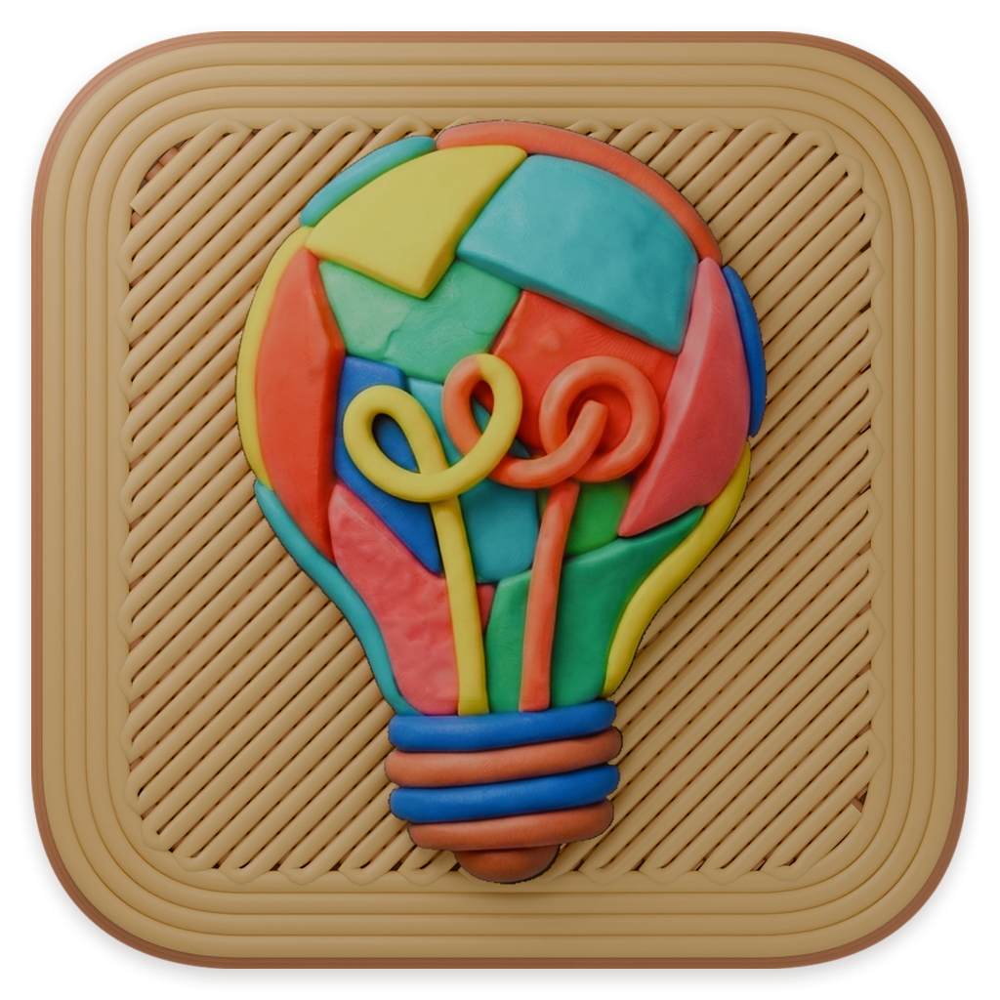

<div align="center">
  
  <h1>Rumi</h1>
  <p>A macOS learning workshop where children design, test, and 3D-print real mechanical things alongside an agent.</p>
  <p>
    <a href="https://github.com/nadirabid/rumi/releases/latest">Download for Apple Silicon</a> ·
    <a href="#learning-by-making">Learning by making</a> ·
    <a href="#safe-and-focused-by-design">Safety</a> ·
    <a href="#under-the-hood">Under the hood</a> ·
    <a href="#getting-started">Getting started</a>
  </p>
</div>

---

Rumi is built for kids to learn how physical things work by making them. Starting from an idea in plain language, a child works back and forth with an agent to shape a 3D model, test how its parts move, fix what jams or breaks, print the pieces separately, and assemble something real by hand — without terminals, CAD jargon, or permission dialogs.

Built on [DeepSeek Harness](https://github.com/deepseek-ai/deepseek-harness) and packaged as a standalone macOS app with its own isolated home (`~/.rumi`), profile, and bundled runtimes.

## Learning by making

- **Real mechanisms, not screen-only toys** — Moving parts are designed to print separately and assemble afterward rather than faked as fused shapes. Replies stay short and in everyday language, keeping measurements and diagnostic output tucked away unless the child asks for them.
- **Point, name, and discover** — Hover over any part of a model to highlight it and see what it is called, with brief definitions for unfamiliar mechanical terms and finer detail revealed as you zoom in. Click a feature to pin it or attach it to the chat, or select by *Local patch*, *Surface*, *Whole part*, or *Edge*.
- **Talk while you point** — Optional full-duplex Live Voice listens quietly until spoken to and captures what the pointer is resting on when speech begins, so *"make this hinge thicker"* refers to the exact surface under the cursor.
- **Hands-on testing and shaping** — Click joint pins directly on the 3D model to swing doors, spin wheels, and test sliders in place. When adjusting proportions, floating glass sliders, 2D pads, curve handles, and live planar cut controls (*Height*, *Tilt*, *Lean*) let kids feel how the shape responds before saving the change.
- **Honest physics feedback before printing** — Behind the scenes, geometry and rigid-body simulation check wall thickness, clearances, and joint movement so kids learn *why* a door jams or a pin slips out — and fix it before wasting filament.
- **Mechanical badges** — Six collectible badges (*Barrel hinge*, *Living hinge*, *Wheel and axle*, *Dovetail slide*, *Gear pair*, and *Rack and pinion*) encourage exploring real mechanical principles across projects. Awards are granted only after background geometry and cross-section review confirms the mechanism in a saved model, celebrated with a Liquid Glass tile reveal.

## Safe and focused by design

- **A workshop tool, never a companion** — Across both text and Live Voice, Rumi stays strictly within the current project and related learning and safety. It does not explore feelings, offer counseling, or build relationships; personal concerns are briefly directed to a parent or trusted adult.
- **Calm, uncluttered workspace** — Rumi opens to a visual project gallery with auto-rendered orthographic covers, automatic project naming from the conversation, and guarded deletion. Exploratory clicks stay recoverable, and every model keeps an immutable revision history for undo.
- **Sandboxed per project** — macOS Seatbelt confines each project's agent to its own folder under `~/.rumi/workspace/`. Bundled runtimes are read-only, the 3D viewer executes no project JavaScript, and Rumi shares no state or credentials with any other install.

## Under the hood

Rumi hides its engineering from the child without cutting corners on the stack:

- **Print Studio & 3D viewport** — Bundles full **Blender 4.5** inside the app (no separate install). Every edit preserves an editable `.blend` original and immutable revisions while publishing self-contained **OpenUSD** previews to a **Three.js** viewport (millimetres, Z-up, depth-scaled spatial shell). Analog deformations and planar cuts preview on the GPU, check endpoints for self-intersections, and bake identically back into the Blender source.
- **Geometry & rigid-body validation** — Runs Blender's **3D Print Toolbox** (manifoldness, thickness, overhangs, clearances) alongside a bundled double-precision **Bullet 3** helper driven by OpenUSD / Isaac Robot joint annotations. Bullet pushes, pulls, and drives moving parts across their declared travel and disassembly paths, reporting exact colliding parts and penetration depths.
- **Plate layout & Bambu Studio** — **Arrange for printing** lays out separately manufactured parts across build plates with drag-to-place, auto-arrange, undo, and spacing/height checks, then exports multi-color **3MF** plates straight into **Bambu Studio** for final review and slicing. Includes optional verified Bambu Studio setup, local SSDP printer discovery, Bambu sign-in, and live local MQTT print progress.
- **Live Voice** — Full-duplex WebRTC (`GPT-Live-1.1`) with single-session enforcement, idle timeout, transcript-to-agent delegation, and speech-onset visual cursor capture.

## Getting started

1. Download the signed, notarized Apple Silicon `.dmg` from [GitHub Releases](https://github.com/nadirabid/rumi/releases/latest), drag **Rumi.app** to `/Applications`, and open it.
2. Open **Rumi → Settings → Models** and connect a provider:
   - **DeepSeek API** (defaults to DeepSeek Flash)
   - **DeepSeek via Baseten**
   - **ChatGPT plan** (browser sign-in)
3. *(Optional)* Add an OpenAI API key under **Plugins → Live Voice** for voice, or configure a Bambu printer under **Plugins → Print Studio**.

Credentials stay in Rumi's local store (`~/.rumi/.credentials.yaml`) and are never included in the installer. Signed builds check for updates automatically and show a **Restart** badge in the header when a newer release is ready.

## Build from source

Requires macOS on Apple Silicon, Node.js `>=24.9.0`, `pnpm`, and the macOS 15 SDK.

```sh
export SDKROOT=/Library/Developer/CommandLineTools/SDKs/MacOSX15.sdk
pnpm install --no-frozen-lockfile
pnpm build
pnpm --filter dsh-rumi run build

# Package an ad-hoc signed local build (no Apple Developer credentials required)
export DSH_DESKTOP_APP_ID=com.nadirmuzaffar.rumi
export npm_execpath="$PWD/node_modules/pnpm/bin/pnpm.mjs"
node node_modules/tsx/dist/cli.mjs apps/rumi/scripts/package-target.ts mac-arm64 --unsigned
```

Install and launch:

```sh
cp -R apps/rumi/.desktop-build/targets/mac-arm64/unsigned-artifacts/mac-arm64/Rumi.app /Applications/
open -a /Applications/Rumi.app
```

## Documentation

- [`RUMI.md`](RUMI.md) — Architecture, bundled runtimes, signing/notarization, release pipeline, and build constraints.
- [`AGENTS.md`](AGENTS.md) — Fork boundaries, allowed paths, and contributor rules.
- [`apps/rumi/plugins/print-studio/README.md`](apps/rumi/plugins/print-studio/README.md) — Print Studio modeling, viewer, validation, badges, and printer handoff.
- [`apps/rumi/plugins/projects/README.md`](apps/rumi/plugins/projects/README.md) — Project gallery, isolation policy, and session routing.
- [`apps/rumi/plugins/live-voice/README.md`](apps/rumi/plugins/live-voice/README.md) — Live Voice transport, delegation, and visual capture.

## License

[MIT](LICENSE). Third-party dependencies and bundled runtime notices are listed in [THIRD_PARTY_NOTICES.md](THIRD_PARTY_NOTICES.md).
